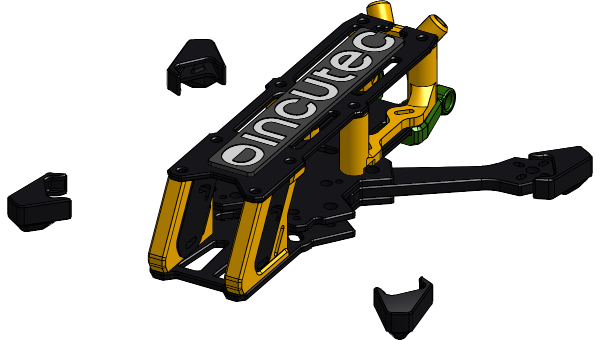

# OpenFrame-3F

The 3" OpenFrame: a CNC carbon fibre freestyle FPV frame in the
incutec OpenDrone line. The 3" and 5" frames are separate repositories:
[OpenFrame-3F](https://github.com/OpenDrone-hw/OpenFrame-3F) and
[OpenFrame-5F](https://github.com/OpenDrone-hw/OpenFrame-5F).

## Where the design lives

| | |
|---|---|
| Source | [Onshape document OpenDrone-V2, workspace 3"](https://cad.onshape.com/documents/78e093d02798373a79bc68d0/w/0fcddf153f58a0417231386c) |
| Link file | [`cad/onshape.json`](cad/onshape.json): document, workspace, element and part ids |
| Released exports | `releases/<rev>/`, exported from a named Onshape version and never edited: [`rev1`](releases/rev1) (2026-07-05, first CNC samples) and [`rev2`](releases/rev2) (2026-10-20, handoff package rev F). The first production batch is cut from rev2 plus the unreleased changes in [`CHANGELOG.md`](CHANGELOG.md) |
| Changes per revision | [`CHANGELOG.md`](CHANGELOG.md), with the hardware list of each revision |
| Parts per set | [`parts.csv`](parts.csv) |
| Fasteners and hardware | [`hardware.csv`](hardware.csv) |
| Standard | Incutec mechanical repository template |

## A set

rev2. 17 part types, 23 pieces, 8 of them carbon. Taken from the
Onshape assembly (version `OpenFrame-3F rev2`, 2026-10-20). Materials are as set in the Onshape model and blank where
the model sets none; the process column is not from the model. Carbon plate and side plate (Standoff-L/R)
thicknesses are measured values.
`Receiver/Antenna-Mount` is kept in the `frame` Part Studio but is not part of the set
(`modelCheck.ignoreUnused` in `cad/onshape.json`), and so is `TopBumpr` until it is placed in the assembly.
`BigBoot`, `Bumpr` and `xt30Mount` are in the assembly and not yet in `parts.csv`; the model check lists them.

| Part | Qty | Material | Thickness | Made by |
|---|---|---|---|---|
| 20mmx4mm | 4 | Aluminum |  | CNC aluminium |
| Airtag/Antenna-Mount | 1 | PLA |  | 3D print, TPU |
| anti-slip pad | 1 |  |  | moulded silicone |
| Arm | 4 | Carbon fiber epoxy (61%) | 4 mm | CNC carbon plate |
| Base-Bot | 1 | Carbon fiber epoxy (61%) | 2.5 mm | CNC carbon plate |
| Base-Top | 1 | Carbon fiber epoxy (61%) | 2.5 mm | CNC carbon plate |
| bootFL | 1 |  |  | 3D print, TPU |
| bootFR | 1 |  |  | 3D print, TPU |
| bootRL | 1 |  |  | 3D print, TPU |
| bootRR | 1 |  |  | 3D print, TPU |
| Cam-Mount-L | 1 | PLA |  | 3D print, TPU |
| Cam-Mount-R | 1 | PLA |  | 3D print, TPU |
| Cross | 1 | Carbon fiber epoxy (61%) | 4 mm | CNC carbon plate |
| Standoff-L | 1 | Aluminum | 6 mm | CNC aluminium |
| Standoff-R | 1 | Aluminum | 6 mm | CNC aluminium |
| Top | 1 | Carbon fiber epoxy (61%) | 2 mm | CNC carbon plate |
| VTX-Mount | 1 | PLA |  | 3D print, TPU |

Fasteners and hardware per set, from the same assembly:

| Item | Qty |
|---|---|
| Hex nut grade A & B M2x0.4 | 4 |
| Hex socket countersunk head screw M2x0.4 x 5 | 4 |
| Hex socket head countersunk screw grade C M3x0.5 x 8 | 2 |
| Button head screw with collar M3x6 (ISO 7380-2) | 1 |
| m2 pressnut | 4 |
| m3 pressnut | 7 |
| Socket button head screw M2x0.4 x 10 | 10 |
| Socket button head screw M2x0.4 x 22 | 4 |
| Socket button head screw M3x0.5 x 10 | 5 |
| Socket button head screw M3x0.5 x 6 | 14 |
| Socket button head screw M3x0.5 x 8 | 2 |
| softmount m2 | 8 |
| Washer M3 | 5 |

Motor screws (16 x M2x6) ship with the motors and are not frame hardware. The middle
plate (Base-Top) has 7 M3 insert holes on the drawing; the assembly places 6 `m3 pressnut`
instances, so `hardware.csv` lists 7 and the model check reports the difference.

## Model checks

Result of the Incutec Onshape model check, run on 2026-10-20 against the live
workspace 3" in the Onshape document. A row stays until the model is fixed.

| Check | Finding |
|---|---|
| Materials | `bootRR`, `BigBoot`, `bootFR`, `bootFL`, `xt30Mount`, `Bumpr`, `anti-slip pad` and `bootRL` have no material set in the model |
| Parts list | `BigBoot`: assembly 1, not in parts.csv; `Bumpr`: assembly 1, not in parts.csv; `xt30Mount`: assembly 1, not in parts.csv |
| Hardware | `m3 pressnut`: hardware.csv 7, assembly 6 |

## Key dimensions

rev2, from the drawing in Onshape (`releases/rev2/drawings/Drawing-1.pdf`).

| | 3" |
|---|---|
| Top plate | 2.0 mm |
| Middle plate | 2.5 mm |
| Bottom plate | 2.5 mm |
| Cross | 4.0 mm |
| Arm | 4.0 mm |
| Side plates (Standoff-L/R) | 6.0 mm |
| M3 bolt holes | Ø3 H8 (3.000-3.010) |
| M2 bolt holes | Ø2.1 |
| Insert holes, middle plate | Ø4.5 (M3), Ø3.5 (M2), reference only: sized to the insert used |
| Countersinks, middle plate | Ø3 + 1.8 mm 45° (M3 countersunk) |
| Bolt-head counterbore, bottom plate | Ø4.1 (M2 button head) |

Chamfers 0.5 mm 45°, outer fillets R1.0 mm, inner fillets R1.05 mm unless the
drawing says otherwise. The cross-to-arm fit is the tightest tolerance in the design:
0.000-0.100 mm between both parts on the drawing.

## Licence

Hardware licensed under [CERN-OHL-S-2.0](https://ohwr.org/cern_ohl_s_v2.txt),
see [LICENSE](LICENSE). Contributing: [CONTRIBUTING.md](CONTRIBUTING.md).
